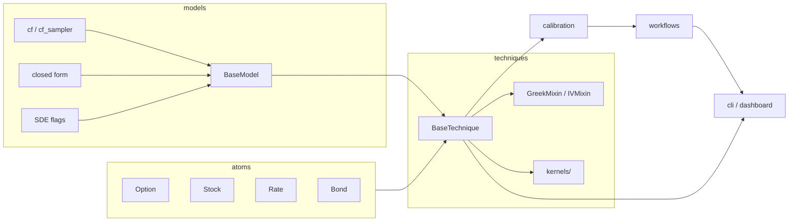

# Architecture

`optpricing` prices one contract with four objects and one call:

```python
technique.price(option, stock, model, rate) -> PricingResult
```

`option`, `stock` and `rate` are the contract and the market. `model` is the
distribution. `technique` is the algorithm. The model does not import a
technique, and a technique does not hard-code a model beyond the capability it
needs (`cf`, a closed form, PDE coefficients, or an SDE). That is why Heston
is priced by COS, by the FFT, by Gauss–Legendre, or by quadratic-exponential
Monte Carlo without a second Heston class, and why a binomial tree refuses
Heston instead of silently treating it as Black–Scholes.



## Atoms

`Option`, `Stock`, `Rate` and `ZeroCouponBond` are frozen data. They carry the
strike, the maturity, the spot, the dividend and the discount curve, and
nothing about how to price. A rate can be a flat number or a curve; the
technique asks `rate.get_rate(T)`.

## Models

`BaseModel` validates parameters and advertises what a technique is allowed to
ask for.

- `supports_cf` — characteristic function of \(\ln S_T\), plus `cf_sampler` for
  the pure-jump laws that can be drawn at expiry.
- `has_closed_form` — Black–Scholes, Merton's series, CEV, SABR's Black price
  from Hagan's implied volatility, Vasicek and CIR bonds, the perpetual put,
  Black's approximation.
- `supports_sde` — a simulation kernel exists. `has_variance_process` selects
  Heston or Bates, `has_jumps` selects Merton, Kou or Bates, `is_pure_levy`
  skips the time grid and samples the terminal law.
- `supports_pde` — spatial coefficients for the Crank–Nicolson solver. Only
  Black–Scholes uses that path.

Parity and the implied rate are models too: they implement the same closed-form
hook, so the rest of the library does not special-case them.

## Techniques

`BaseTechnique.price` is the only required method. `GreekMixin` and `IVMixin`
add delta, gamma, vega, theta, rho and implied volatility. A technique that can
see the derivative on its own grid (the PDE, the trees, COS) overrides the
bump. The others use a numerical bump through `price`, so a new technique gets
Greeks without a new formula.

The heavy numerical code sits in `techniques/kernels/`: numba Monte Carlo and
Longstaff–Schwartz, and the numpy lattice and PDE sweeps. The technique class
is the policy (step count, American flag, damping, seed). The kernel is the
loop.

Which technique runs is a property of the model, not a global default.
`select_fastest_technique` returns the closed form when there is one, and COS
for a characteristic function. Quadrature and the FFT stay available when you
ask for them.

## Calibration

A chain is a column of the same `price` contract. `price_options_vectorized`
dispatches a whole book: vectorised closed form, COS or Gauss–Legendre on the
characteristic function, or Monte Carlo with common random numbers per
maturity. The calibrator minimises against that vector. Filters
(`LiquidityFilter`) decide which rows are allowed into the fit. Jump-model
priors are fit from the equity history, separate from the option chain.

## Workflows, CLI, dashboard

`DailyWorkflow` and `BacktestWorkflow` load a snapshot, filter it, calibrate,
and score the next day. They do not price. The CLI (`price`, `calibrate`,
`backtest`, `tune`, `data`, `dashboard`) and the Streamlit pages call the same
functions. The dashboard is a view. It is not on the import path of the
library, and the type checker does not include it.

## What this buys

Adding a model means implementing `BaseModel` and one representation. The
techniques you did not write still price it, or they raise `TypeError` with
the name of the model. Adding a technique means implementing `price` against
that representation. Calibration, the CLI and the dashboard pick it up through
the same call.
