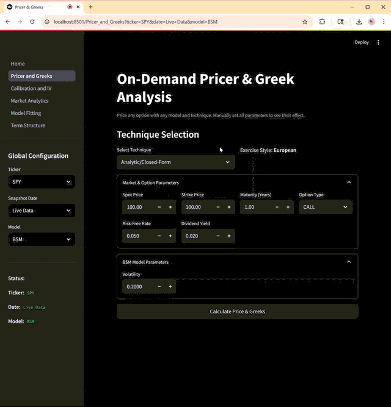

# OptPricing

[](https://github.com/diljit22/optpricing/actions/workflows/ci.yml)
[](https://codecov.io/gh/diljit22/optpricing)
[](https://github.com/diljit22/optpricing/actions/workflows/pages.yml)
[](https://pypi.org/project/optpricing/)
[](https://www.python.org/downloads/)
[](https://github.com/astral-sh/ruff)
[](https://opensource.org/licenses/MIT)

**[Live dashboard](https://optpricing.streamlit.app/)** · **[Documentation](https://diljit22.github.io/optpricing/)**

17 pricing models and 10 techniques. Heston matches QuantLib 1.44 to 5e-10, and a 400-option Heston chain prices in 1.55 ms.

Diljit Singh · [LinkedIn](https://linkedin.com/in/singhdiljit/)



The model is the distribution and the technique is the algorithm. The call is always `technique.price(option, stock, model, rate)`. Heston has no closed form, so the default technique is COS (Fang–Oosterlee). The same model also prices by Carr–Madan FFT and by Andersen's quadratic-exponential Monte Carlo. Design notes are in [ARCHITECTURE.md](ARCHITECTURE.md). The formulas are in [Methods](docs/guide/methods.md).

---

## Quick start

Python 3.11–3.14. The block below does not use the network.

```bash
pip install optpricing
```

```python
from optpricing import (
    BSMModel,
    COSTechnique,
    ClosedFormTechnique,
    FFTTechnique,
    HestonModel,
    MonteCarloTechnique,
    Option,
    OptionType,
    Rate,
    Stock,
)

option = Option(strike=100.0, maturity=1.0, option_type=OptionType.CALL)
stock = Stock(spot=100.0, dividend=0.01)
rate = Rate(rate=0.05)

bsm = BSMModel(params={"sigma": 0.20})
analytic = ClosedFormTechnique()
print(f"BSM price {analytic.price(option, stock, bsm, rate).price:.4f}")
print(f"delta    {analytic.delta(option, stock, bsm, rate):.4f}")

heston = HestonModel(
    params={
        "v0": 0.04,
        "kappa": 2.0,
        "theta": 0.05,
        "rho": -0.7,
        "vol_of_vol": 0.3,
    }
)
cos = COSTechnique().price(option, stock, heston, rate).price
fft = FFTTechnique().price(option, stock, heston, rate).price
mc_engine = MonteCarloTechnique(n_paths=50_000, n_steps=100, seed=1)
mc = mc_engine.price(option, stock, heston, rate).price
print(f"Heston  COS {cos:.4f}   FFT {fft:.4f}   MC {mc:.4f}")
print(f"COS - FFT = {cos - fft:.2e}")
```

`pip install "optpricing[ui]"` adds the Streamlit dashboard (`optpricing dashboard`). The CLI can price a live chain (`optpricing price --ticker AAPL ...`); that call downloads the chain and needs a network.

---

## Validation

Maximum absolute error on the contracts in `tests/correctness/`. The reference is a QuantLib 1.44 value pinned in those tests, or a closed form. Heston is 5e-10 against `AnalyticHestonEngine` (7e-10 on the vectorised chain). The largest closed-form gap is CEV near γ = 1, at 6e-8, where the test allows 1e-7. Reprint the table with `uv run python benchmarks/accuracy.py`. The copy with the worst case of each row is in [Validation](docs/guide/validation.md).

<!-- accuracy-summary -->
| Model | Technique | Reference | Cases | Max abs error |
| --- | --- | --- | ---: | ---: |
| Heston | COS | QuantLib 1.44 AnalyticHestonEngine | 18 | 5.0e-10 |
| Heston | Gauss-Legendre | QuantLib 1.44 AnalyticHestonEngine | 18 | 5.0e-10 |
| Heston | FFT | QuantLib 1.44 AnalyticHestonEngine | 5 | 5.0e-10 |
| Heston | chain COS | QuantLib 1.44 AnalyticHestonEngine | 4 | 7.0e-10 |
| Heston | chain Gauss-Legendre | QuantLib 1.44 AnalyticHestonEngine | 4 | 4.1e-11 |
| NIG | COS | COS, N=2^18 (Fang and Oosterlee truncation) | 3 | 8.2e-11 |
| NIG | Gauss-Legendre | COS, N=2^18 (Fang and Oosterlee truncation) | 3 | 8.2e-11 |
| NIG | chain COS | COS, N=2^18 (Fang and Oosterlee truncation) | 3 | 5.2e-10 |
| NIG | chain Gauss-Legendre | COS, N=2^18 (Fang and Oosterlee truncation) | 3 | 8.2e-11 |
| Hyperbolic | COS | COS, N=2^18 (Fang and Oosterlee truncation) | 1 | 1.6e-11 |
| Hyperbolic | Gauss-Legendre | COS, N=2^18 (Fang and Oosterlee truncation) | 1 | 1.6e-11 |
| Hyperbolic | chain COS | COS, N=2^18 (Fang and Oosterlee truncation) | 1 | 3.5e-11 |
| Hyperbolic | chain Gauss-Legendre | COS, N=2^18 (Fang and Oosterlee truncation) | 1 | 1.6e-11 |
| Kou | COS | COS, N=2^18, on the paper characteristic function | 3 | 2.3e-11 |
| Kou | Gauss-Legendre | COS, N=2^18, on the paper characteristic function | 3 | 2.3e-11 |
| NIG | COS | COS, N=2^18, on the paper characteristic function | 3 | 4.5e-11 |
| NIG | Gauss-Legendre | COS, N=2^18, on the paper characteristic function | 3 | 4.5e-11 |
| Hyperbolic | COS | COS, N=2^18, on the paper characteristic function | 3 | 4.3e-11 |
| Hyperbolic | Gauss-Legendre | COS, N=2^18, on the paper characteristic function | 3 | 4.3e-11 |
| VG | COS | Fang and Oosterlee (2008) | 1 | 2.0e-10 |
| VG | Gauss-Legendre | Fang and Oosterlee (2008) | 1 | 2.0e-10 |
| CGMY | COS | Fang and Oosterlee (2008) | 2 | 4.8e-10 |
| CGMY | Gauss-Legendre | Fang and Oosterlee (2008) | 2 | 4.8e-10 |
| KOU | FFT | COS, N=2^18, on the paper characteristic function | 6 | 2.7e-11 |
| CGMY | FFT | COS, N=2^18, on the paper characteristic function | 4 | 5.3e-10 |
| NIG | FFT | COS, N=2^18, on the paper characteristic function | 3 | 4.5e-11 |
| VG | COS | COS, N=2^22, fixed range | 3 | 1.1e-07 |
| CGMY | COS | COS, N=2^22, fixed range | 3 | 5.3e-07 |
| Bates | COS | QuantLib 1.44 BatesEngine | 6 | 4.4e-11 |
| Bates | Gauss-Legendre | QuantLib 1.44 BatesEngine | 8 | 3.6e-10 |
| Merton | closed form | Merton (1976) series, 80 terms | 2 | 4.6e-10 |
| Merton | Gauss-Legendre | Merton (1976) series, 80 terms | 2 | 4.8e-10 |
| Merton | closed form | Gil-Pelaez quadrature | 1 | 1.0e-11 |
| Vasicek | closed form | QuantLib 1.44 discount bond | 4 | 4.9e-11 |
| CIR | closed form | QuantLib 1.44 discount bond | 4 | 4.1e-11 |
| Black's approximation | closed form | Hull, Black's approximation | 4 | 4.8e-11 |
| Perpetual put | closed form | Merton (1973) perpetual put | 8 | 7.1e-15 |
| CEV | closed form | Hull CEV formula (zero rates also QuantLib 1.44) | 3 | 4.2e-10 |
| CEV | Monte Carlo | Hull CEV formula (zero rates also QuantLib 1.44) | 3 | 8.6e-03 |
| CEV | closed form | QuantLib 1.44 AnalyticCEVEngine | 27 | 6.0e-08 |
| BSM | CRR | BSM closed form | 1 | 2.0e-03 |
| BSM | Leisen-Reimer | BSM closed form | 1 | 1.5e-06 |
| BSM | TOPM | BSM closed form | 1 | 9.8e-04 |
| BSM | Crank-Nicolson | BSM closed form | 1 | 5.4e-03 |
| BSM American | CRR | QuantLib 1.44 FdBlackScholesVanillaEngine | 2 | 4.8e-04 |
| BSM American | Leisen-Reimer | QuantLib 1.44 FdBlackScholesVanillaEngine | 2 | 2.9e-04 |
| BSM American | TOPM | QuantLib 1.44 FdBlackScholesVanillaEngine | 2 | 5.6e-04 |
| BSM American | LSMC | QuantLib 1.44 FdBlackScholesVanillaEngine | 2 | 2.1e-02 |
| BSM | FFT | COSTechnique | 3 | 1.8e-13 |
| BSM | Gauss-Legendre | COSTechnique | 3 | 4.3e-14 |
| BSM | COS | BSM closed form | 3 | 6.4e-14 |
| Heston | FFT | COSTechnique | 3 | 7.8e-14 |
| Heston | Gauss-Legendre | COSTechnique | 3 | 4.3e-14 |
| Merton | FFT | COSTechnique | 3 | 1.6e-13 |
| Merton | Gauss-Legendre | COSTechnique | 3 | 6.4e-14 |
| Bates | FFT | COSTechnique | 3 | 1.2e-13 |
| Bates | Gauss-Legendre | COSTechnique | 3 | 4.3e-14 |
| Kou | FFT | COSTechnique | 3 | 1.2e-10 |
| Kou | Gauss-Legendre | COSTechnique | 3 | 1.4e-14 |
| VG | FFT | COSTechnique | 3 | 1.5e-13 |
| VG | Gauss-Legendre | COSTechnique | 3 | 6.2e-08 |
| NIG | FFT | COSTechnique | 3 | 1.0e-13 |
| NIG | Gauss-Legendre | COSTechnique | 3 | 7.1e-14 |
| CGMY | FFT | COSTechnique | 3 | 1.7e-13 |
| CGMY | Gauss-Legendre | COSTechnique | 3 | 4.3e-14 |
| Hyperbolic | FFT | COSTechnique | 3 | 1.8e-13 |
| Hyperbolic | Gauss-Legendre | COSTechnique | 3 | 6.4e-14 |
<!-- /accuracy-summary -->

<!-- accuracy-convergence -->
| Scheme | Resolutions | Measured slopes | Mean | Theory |
| --- | --- | --- | ---: | ---: |
| CRR | 200, 400, 800 | -1.00, -1.00 | -1.00 | -1.00 |
| TOPM | 200, 400, 800 | -1.00, -1.00 | -1.00 | -1.00 |
| Leisen-Reimer | 101, 201, 401 | -1.99, -1.99 | -1.99 | -2.00 |
| Crank-Nicolson | 100, 200, 400 | -2.05, -1.98 | -2.01 | -2.00 |
| Monte Carlo | 2,048 and 32,768 paths | -0.45 | -0.45 | -0.50 |
<!-- /accuracy-convergence -->

Trees and Monte Carlo are in the table on purpose: an American CRR price is not a 1e-9 result, and the Monte Carlo slope is the standard-deviation slope, not a price error.

---

## Performance

Medians of 15 runs from `benchmarks/run_benchmarks.py`, committed in `benchmarks/results/2026-11-18-arm64.json`. Same machine, same git revision, warm start (the numba compile is not in the median). Descriptions of each case are in that file. `mc_bsm_100k` is Euler on the log-spot, 100k paths by 100 steps, not an exact terminal draw. `lr_am_5000` asks for 5000 steps and the kernel runs 5001, because Leisen–Reimer wants an odd count. `mc_heston_100k` is Andersen's quadratic-exponential scheme.

<!-- perf-table -->
| Case | Median (ms) | Machine | git |
| --- | ---: | --- | --- |
| `bsm_closed_form_x1000` | 1.34 | macOS-26.6.2-arm64-arm-64bit | `8982010-dirty` |
| `heston_fft` | 0.36 | macOS-26.6.2-arm64-arm-64bit | `8982010-dirty` |
| `heston_integration` | 0.06 | macOS-26.6.2-arm64-arm-64bit | `8982010-dirty` |
| `cn_pde_200x200` | 0.28 | macOS-26.6.2-arm64-arm-64bit | `8982010-dirty` |
| `crr_am_1000` | 11.12 | macOS-26.6.2-arm64-arm-64bit | `8982010-dirty` |
| `crr_am_5000` | 161.44 | macOS-26.6.2-arm64-arm-64bit | `8982010-dirty` |
| `lr_am_5000` | 160.49 | macOS-26.6.2-arm64-arm-64bit | `8982010-dirty` |
| `mc_bsm_100k` | 3.16 | macOS-26.6.2-arm64-arm-64bit | `8982010-dirty` |
| `mc_heston_100k` | 23.34 | macOS-26.6.2-arm64-arm-64bit | `8982010-dirty` |
| `lsmc_bsm_20k` | 11.82 | macOS-26.6.2-arm64-arm-64bit | `8982010-dirty` |
| `heston_chain_400` | 1.55 | macOS-26.6.2-arm64-arm-64bit | `8982010-dirty` |
<!-- /perf-table -->

---

## Also in the box

* **Models.** Stochastic volatility (Heston, SABR), jumps (Merton, Bates, Kou, SABR with jumps), pure Lévy (VG, NIG, CGMY, Hyperbolic), local volatility (CEV, Dupire), rates (Vasicek, CIR), Black's approximation, the perpetual put, and parity / implied rate.
* **Techniques.** Closed form, COS, Carr–Madan FFT, Gauss–Legendre, Crank–Nicolson, CRR, Leisen–Reimer, trinomial, European Monte Carlo, Longstaff–Schwartz.
* **Offline chain.** Calibrate and walk a snapshot forward without a live download. `optpricing calibrate`, `backtest`, `tune`.
* **Dashboard.** [optpricing.streamlit.app](https://optpricing.streamlit.app/).

Guides: [Introduction](https://diljit22.github.io/optpricing/guide/introduction/), [Installation](https://diljit22.github.io/optpricing/guide/installation/), [Getting started](https://diljit22.github.io/optpricing/guide/getting_started/), [Methods](docs/guide/methods.md), [Validation](docs/guide/validation.md), [API](https://diljit22.github.io/optpricing/guide/API/), [CLI](https://diljit22.github.io/optpricing/guide/CLI/), [Examples](https://diljit22.github.io/optpricing/guide/examples/).

## Contributing

See [CONTRIBUTING](CONTRIBUTING.md).

## License

MIT. See [LICENSE](LICENSE).
