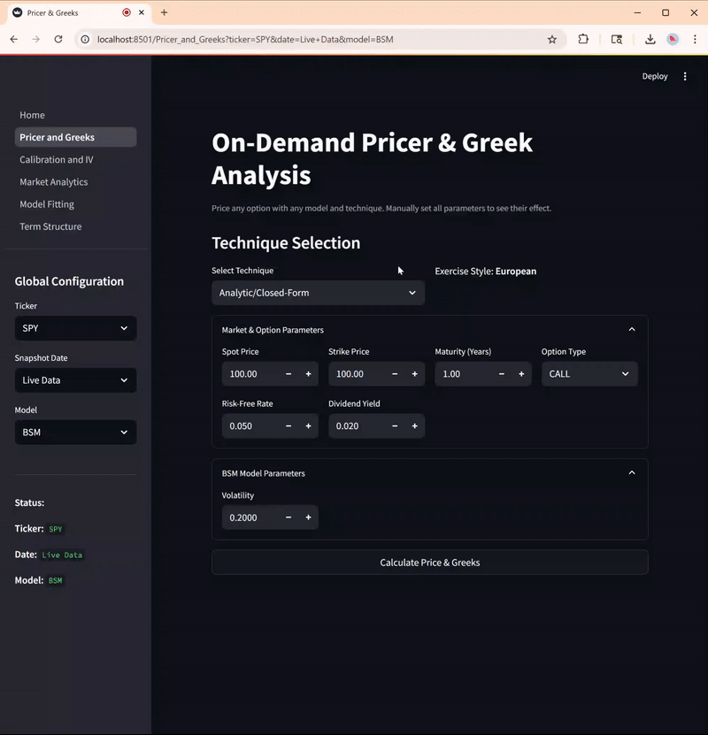

# OptPricing: A Quantitative Finance Library for Derivative Pricing and Analysis

`optpricing` is a Python library for pricing, calibrating, and analyzing financial derivatives. It is built with a focus on architectural clarity, model breadth, and practical usability through a robust API, command-line interface, and an interactive dashboard.

Diljit Singh
[LinkedIn](https://linkedin.com/in/singhdiljit/)

{ width="50%" style="display: block; margin-left: auto; margin-right: auto;" }

---

## Core Features

**Model Library**: Implements a comprehensive set of models, including:

* **Stochastic Volatility**: Heston, SABR
* **Jump-Diffusion**: Merton, Bates, Kou, SABR with Jumps
* **Pure Levy Processes**: Variance Gamma (VG), Normal Inverse Gaussian (NIG), CGMY, Hyperbolic
* **Interest Rate Models**: Vasicek, Cox-Ingersoll-Ross (CIR), Put-Call Parity Implied Rate
* **Local Volatility**: CEV, Dupire

**Pricing Engines**: Provides a suite of numerical methods, allowing for technique comparison and validation:

* Analytic closed-form solutions
* Characteristic-function pricing: COS (Fang–Oosterlee), numerical integration, and Carr–Madan FFT
* Finite difference (PDE) solver using a Crank-Nicolson scheme
* Binomial and trinomial tree methods (CRR, TOPM, Leisen-Reimer) for European and American Black–Scholes options
* High-performance Monte Carlo engine for European and American options, accelerated with `numba`, with antithetic variates

**Interfaces**:

* **Programmatic API**: Use the package as a Python library to build custom financial models in your scripts. Define options, stocks, rates, and models programmatically to compute prices and other metrics.
* **Command-Line Interface (CLI)**: A robust CLI for live pricing, data management, model calibration, and historical backtesting.
* **Interactive Dashboard (UI)**: A Streamlit application for visual analysis of option chains, implied volatility surfaces, and model calibrations.

* **Workflow Automation**: High-level classes that orchestrate complex tasks like daily calibration runs and out-of-sample performance evaluation.

### Guides

* [Introduction](https://diljit22.github.io/optpricing/guide/introduction/)
* [Installation](https://diljit22.github.io/optpricing/guide/installation/)
* [Getting Started](https://diljit22.github.io/optpricing/guide/getting_started/)
* [CLI](https://diljit22.github.io/optpricing/guide/CLI/)
* [Dashboard](https://diljit22.github.io/optpricing/guide/dashboard/)
* [API](https://diljit22.github.io/optpricing/guide/API/)
* [Examples](https://diljit22.github.io/optpricing/guide/examples/)
* [API Reference](reference/index.md)
